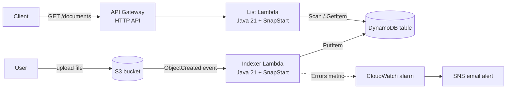

# Claims Document Tracker

An event-driven, serverless document indexing service on AWS, built with **Java 21**, **AWS Lambda (SnapStart)**, **Amazon S3**, **Amazon DynamoDB** and **Amazon API Gateway**, and deployed entirely from one **AWS SAM** template.

Upload a file to S3 and it is indexed automatically within seconds. Query the index over a public HTTP API.

---

## Architecture



**Write path:** a file lands in S3 → S3 invokes the indexer Lambda asynchronously → the Lambda records the file's metadata in DynamoDB.

**Read path:** a client calls the HTTP API → API Gateway invokes the list Lambda → the Lambda reads DynamoDB and returns JSON.

---

## API

| Method | Path | Description | DynamoDB call |
|---|---|---|---|
| `GET` | `/documents` | All indexed documents, newest first (up to 100) | `Scan` + in-code sort |
| `GET` | `/documents/{id}` | One document by file name, or `404` | `GetItem` |

Example response for `GET /documents/{id}`:

```json
{
  "documentId": "knee surgery claim.txt",
  "bucket": "claims-tracker-sam-documentsbucket-xxxx",
  "sizeBytes": 57,
  "uploadedAt": "2026-11-10T02:49:23.441426216Z"
}
```

File names with spaces are URL-encoded in the path (`knee%20surgery%20claim.txt`).

---

## Tech stack

- **Runtime:** Java 21 on AWS Lambda (arm64 / Graviton)
- **Compute:** AWS Lambda with SnapStart, published versions and a `live` alias
- **Storage:** Amazon S3 (documents), Amazon DynamoDB on-demand (metadata index)
- **API:** Amazon API Gateway HTTP API with throttling
- **Observability:** CloudWatch Logs (7-day retention), CloudWatch alarm, SNS email alerts
- **Infrastructure as code:** AWS SAM (CloudFormation)
- **Build:** Maven, AWS SDK for Java v2 (URL connection HTTP client), Jackson

---

## Project structure

```
.
├── template.yaml                              # The whole system: bucket, table, functions, roles, API, alarm
├── pom.xml
├── events/
│   └── s3-test-event.json                     # Sample S3 event for local or manual testing
└── src/main/
    ├── java/com/yuvaraj/claims/
    │   ├── DocumentHandler.java               # Indexer: S3 event -> DynamoDB
    │   └── ListDocumentsHandler.java          # API: list and get-by-id
    └── resources/
        └── simplelogger.properties            # SLF4J binding config for AWS SDK logs
```

---

## Deploy

### Prerequisites

- AWS account and the AWS CLI configured with an IAM user (not root)
- AWS SAM CLI
- Java 21 and Maven

### Build and deploy

```bash
sam build
sam deploy --guided
```

The guided deploy asks for a stack name, region and an `AlertEmail` for error alerts. Confirm the SNS subscription email afterwards. Later deploys are just:

```bash
sam build && sam deploy
```

Every deploy publishes a new Lambda version with a fresh SnapStart snapshot and moves the `live` alias to it, so rolling back is a single alias update.

### Try it

```bash
BUCKET=<BucketName from the stack outputs>
API=<ApiUrl from the stack outputs>

aws s3 cp "my claim.txt" "s3://$BUCKET/my claim.txt"
sleep 15
curl -s "$API" | python3 -m json.tool
curl -s "$API/my%20claim.txt" | python3 -m json.tool
```

### Clean up

The bucket must be empty before the stack can be deleted:

```bash
aws s3 rm "s3://$BUCKET" --recursive
sam delete
```

---

## Design decisions

- **Least privilege per function.** Each Lambda has its own role. The indexer can only `PutItem` (plus `DescribeTable` for priming) on one table; the API function can only `Scan` and `GetItem`. A bug in the public-facing function cannot modify data.
- **Scoped resource-based policies.** S3 may invoke the indexer only from this bucket and this account, protecting against the confused deputy problem. API Gateway may invoke the list function only through this API's routes.
- **Configuration outside code.** The table name comes from the `TABLE_NAME` environment variable set by the template, so the same code runs in any stack.
- **Defensive handling of schemaless data.** DynamoDB items may not all have the same attributes, so every field is read null-safely.
- **Correct key decoding.** S3 URL-encodes object keys in events (`my file.pdf` arrives as `my+file.pdf`), so keys are decoded before being stored.
- **UTC timestamps, sorted as `Instant`.** Timestamps with different fractional precision would mis-sort as strings, so sorting parses them first.
- **Safe errors.** The API returns a generic `500` to callers and logs the details to CloudWatch, never exposing internals publicly.
- **Throttling on a public endpoint.** 5 requests per second (burst 10). Excess requests get a `429` from API Gateway without invoking Lambda, capping cost and abuse.
- **Scan is acceptable here because the table is small.** For a large table, list queries would use a key design or a secondary index with `Query` instead.
- **Slim deployment package.** Unused Netty and Apache HTTP clients are excluded in favour of the lightweight URL connection client: fewer dependencies, fewer vulnerabilities, a smaller JAR (14 MB → 8 MB) and faster cold starts.

---

## Cold start investigation: SnapStart and priming

Java on Lambda has slow cold starts, so I measured each optimisation rather than assuming it worked.

| Cold start | Init / restore | Handler duration | Total |
|---|---|---|---|
| No SnapStart | 1,295 ms init | 3,418 ms | ~4.7 s |
| SnapStart, priming not running | 437–775 ms restore | 3,271–4,577 ms | ~4–5 s |
| **SnapStart + working priming** | **539–722 ms restore** | **859–977 ms** | **~1.4–1.7 s** |
| Warm invocation (for reference) | none | 14–88 ms | |

**What happened:**

1. SnapStart halved startup time, but the first request was still ~4 s. The snapshot contained a *created* DynamoDB client that had never made a call, so the first `PutItem` still paid for class loading, credential fetching and the TLS handshake.
2. I added priming in a CRaC `beforeCheckpoint` hook, but the numbers did not move.
3. Diagnostic logging showed the hook **never ran**: no priming output during publishing, and no `afterRestore` output on restore.
4. Root cause: the handler implemented `org.crac.Resource` but never called `Core.getGlobalContext().register(this)`, so Lambda never knew to invoke the hooks.
5. After the fix, the handler's cold-start duration dropped by about 75%, for a total cold start of roughly a third of the original.

The list function primes the exact code paths it serves (a one-item scan with JSON serialisation, plus a `GetItem` on a dummy key), so publishing also verifies its IAM permissions before any user request.

---

## Possible next steps

- Authentication on the API (JWT authorizer)
- Pagination for large result sets
- Unit tests that build `S3Event` and API Gateway events directly
- A Bedrock Knowledge Base over the same bucket for document Q&A and summarisation
